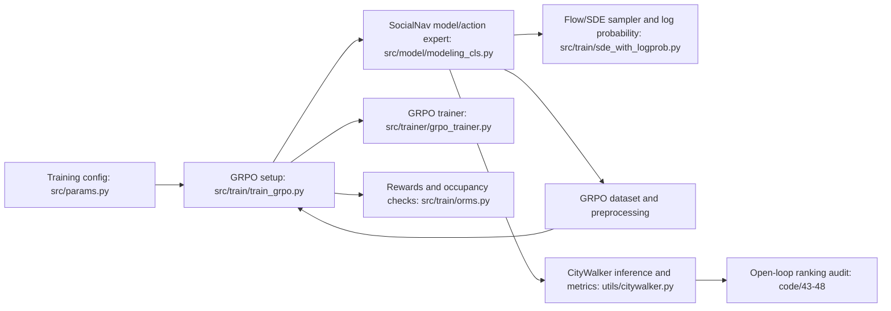

# SocialNav Audit & Planner Knowledge Base

## Mục đích
Repo này là gói bàn giao cho đồng tác giả/mentor: mô tả dự án, bản trích source code upstream liên quan tới cấu hình Flow Matching/Diffusion Planner và rank/đánh giá, kết quả audit có thể tái tạo, cùng các báo cáo trình bày. Đây **không** phải bản fork hoàn chỉnh để train từ đầu; checkpoints, raw CityWalker/Penn-Fudan và cache không nằm trong repo.

## Câu chuyện dự án

1. **Nền:** SocialNav dùng VLM làm semantic/social reasoning và action expert tạo chuỗi waypoint; nhánh code upstream có Flow Matching/GRPO hỗ trợ sinh hành động.
2. **Bài toán audit:** kiểm tra bộ chọn trajectory/risk scoring và guidance trong open-loop với pedestrian futures tổng hợp; so sánh point (pt), expected (exp), CVaR và guided rerank trên cùng protocol held-out.
3. **Điều quan sát được:** trong cell `il3_s0 / ped_headon_3m`, script 48 cho guided rerank + expected-risk contact 4.71% so với expected-risk 30.30%; primary paired contrast −25.58 điểm phần trăm, CI sprite-conditional [−27.30, −23.90]. Đồng thời lateral deviation tăng (0.66→1.36 m) và origin-inclusive turn tăng (18.8→34.0°): có trade-off rõ.
4. **Diễn giải:** script 48 là **baseline repair/matched held-out cell**, không phải đóng góp phương pháp mới. Compute không matched (guidance có forward/backward; rerank chỉ forward). Đây là contact proxy trong open-loop synthetic futures, không chứng minh an toàn hay hiệu năng closed-loop.
5. **Quyết định:** GO có điều kiện cho phase tiếp theo về social navigation nếu bổ sung dữ liệu người đi bộ chuyển động, đánh giá closed-loop, đo path efficiency/goal success/comfort và ràng buộc giới hạn lệch ngang/độ ngoặt. NO-GO cho claim “đã chứng minh an toàn”, “đánh bại SocNav paper” hoặc “4.7% là kết quả của proposed method”.

## Code map: Flow/Diffusion planner và ranking



| Đường dẫn | Vai trò / chỗ nên đọc |
|---|---|
| `code/socialnav_core/src/params.py` | Dataclass config. `action_dim`, `action_chunk`, `flow_matching_policy`, `num_flow_steps`, `action_former`, `sigma`, `min_value/max_value`, các cờ freeze và learning rates; xem `TrainingArguments` và `GRPOArguments`. |
| `code/socialnav_core/src/train/train_grpo.py` | Wiring train: cấu hình model, flow/action-former freeze, khởi tạo config và trainer. Điểm vào từ `configure_flow_matching` và chỗ truyền các trường action/flow vào model. |
| `code/socialnav_core/src/model/modeling_cls.py` | Model Qwen-VL/model wrapper; đường tạo logits/action và cấu trúc module. Đọc kèm `train_grpo.py` để phân biệt model wrapper classifier với action expert trong nhánh upstream. |
| `code/socialnav_core/src/train/sde_with_logprob.py` | Hai sampler `ConditionalFlowMatcherWithSigmaSchedule` và `_CPS`, lịch timestep, update SDE và log-prob dùng trong sampling/training. Không đồng nhất tên “Diffusion” với DDPM mặc định: đây là flow-matching scheduler tùy biến. |
| `code/socialnav_core/src/trainer/grpo_trainer.py` | Vòng lặp GRPO, sinh completion, reward, policy optimization. |
| `code/socialnav_core/src/train/orms.py` | Reward functions (format/accuracy/occupancy/smoothness/expert similarity/distance map) và coordinate transform. Đây là reward/training evaluator, khác với hậu xử lý rerank trong audit. |
| `code/socialnav_core/src/train/reward_funcs.py` | Reward utilities bổ sung. |
| `code/socialnav_core/src/dataset/grpo_dataset.py`, `data_utils.py` | Đọc/chuẩn hóa mẫu cho GRPO. |
| `code/socialnav_core/utils/citywalker.py` | Inference trên CityWalker và các metric waypoint/arrival/angle. Không phải benchmark closed-loop SocNav paper. |
| `code/43_rerank_baseline.py` | Candidate reranking ban đầu; `rerank16g` có oracle-advantaged future velocity, chỉ là upper bound. |
| `code/44_uncertainty_planning.py` | Point/expected/CVaR selector và perturbation audit; in-sample. |
| `code/46_heldout_v2.py` | Protocol held-out futures được dùng làm nền cho 48. |
| `code/47b_diversity_audit.py` | Candidate diversity audit; `div_pw` là diversity, không phải độ chính xác dự báo. |
| `code/48_matched_guided_rerank.py` | Held-out guided-rerank audit; kết quả chính ở `results/results_48_guided_rerank.json` và raw arrays NPZ. |

## Cấu hình đọc nhanh

`action_chunk=5`, `action_dim=2` nghĩa là action/waypoint có hai chiều và chunk mặc định dài năm bước. `num_flow_steps=3` là số bước flow inference cấu hình mặc định ở các dataclass liên quan; `flow_matching_policy` bật/tắt nhánh policy tùy training config. `freeze_flow_matching`, `freeze_action_former`, `freeze_input_wp_encoder` kiểm soát gradient. `sigma`/`noise_level` liên quan stochasticity sampler. Giá trị thực tế phải đọc từ arguments/checkpoint của lần chạy cụ thể; default trong file không khẳng định đúng config của mọi checkpoint.

Ranking trong audit là lựa chọn trajectory candidate theo energy/risk score: `pt` dùng point/nominal score; `exp` kỳ vọng qua futures; `cvar` tail-risk; `gui` candidate pool có guidance; `guided_rr_*` rerank candidates trong guided pool theo selector tương ứng. Hậu kiểm `hel` lấy contact trên held-out futures; đây không phải reward GRPO và cũng không phải metric SocNav benchmark.

## Dataset và phạm vi dữ liệu công bố

- Kiểm kê CityWalker cục bộ: 18 trajectory, 18,551 ảnh; pose có 42,714 dòng tương ứng 14,238 records (3 dòng/record). Đây là số kiểm kê local, không đồng nghĩa số sample dùng trong mọi thí nghiệm.
- Metadata train cache kiểm kê: 19,205 + Penn-Fudan 1,900 = 21,105 sample; cache khoảng 83.08 GB. Các ảnh/raw cache không được commit.
- Audit 48 chạy 608/1,900 state theo 38 whole batches; metric head-on dùng 380 state, 306 sprites, 19 windows. 32 futures/state không độc lập như 32 scene.
- Chỉ một trong năm điều kiện audit có pedestrian motion (`ped_headon_3m`); các điều kiện còn lại là pedestrian tĩnh.
- Dataset item nội bộ, frames, poses, cache, credentials, checkpoint/weights không được đưa lên Git. README chia sẻ cần ghi rõ cách xin quyền truy cập riêng.

## Kết quả, bằng chứng và tái tạo

| Khẳng định | Bằng chứng |
|---|---|
| Primary 48: guided_rr_exp − exp = −25.58 pp, sprite CI [−27.30, −23.90] | `results/results_48_guided_rerank.json` → `res.il3_s0.per_cond.ped_headon_3m.PRIMARY_d_hel_guided_rr_exp_minus_exp` |
| `guided_rr_exp` held-out contact 4.71%, `exp` 30.30% | Cùng JSON → `res.il3_s0.per_cond.ped_headon_3m.hel_guided_rr_exp.mean` và `hel_exp.mean` |
| Geometry trade-off: lateral 0.66→1.36 m; turn 18.8→34.0° | Cùng JSON → `lat_exp`, `lat_guided_rr_exp`, `turn_origin_exp`, `turn_origin_guided_rr_exp` |
| Held-out reversal, script 46 | `results/results_46_heldout.json` → `res.il3_s0.ped_headon_3m.d_hel_exp_pt` |
| Diversity (không phải accuracy) | `results/results_47b_diversity.json` → `res.<policy>.ped_headon_3m.div_pw` |
| Raw trajectory/contact arrays | `results/raw_48_guided_rerank.npz` (608 states/policy; arrays 32×608). |

Reproduce JSON-derived tables (Python stdlib, không GPU/model):

```powershell
python code/reproduce_tables.py
```

Có thể kiểm tra pipeline/test hình học trên môi trường upstream có PyTorch/numpy:

```powershell
python code/test_48_pipeline.py
python code/test_48_geometry.py
```

Các script thí nghiệm ban đầu dùng đường dẫn local cố định trong `code/sn_common.py` (`C:\Users\N4G\qcom_socialnav`). Chúng chỉ chạy lại nguyên trạng nếu người dùng tự chuẩn bị repo/model/data/venv đó hoặc sửa config đường dẫn; không có model weights/dataset trong repo này.

## Giới hạn claim

- 48 không phải proposed method, không matched compute.
- Held-out chỉ hold out futures, không hold out scenes; subset 608/1900 states có chứa 380 head-on states.
- CI là sprite-conditional trên 19 fixed windows; window spread là mô tả, không phải CI.
- `hel` là tỷ lệ contact trung bình state×futures; không phải fraction states collision-free, collision rate closed-loop hay safety guarantee.
- `progress_vs_gt` là endpoint norm ratio, không phải goal success/path length.
- `lat` đo so với pool mean; energy lateral penalty dùng đối chứng unguided riêng, hai tham chiếu khác nhau.
- Không đặt trực tiếp con số audit cạnh SR/DCR/SPL/MAOE của paper SocNav như cùng scale.
- 47 moving-pedestrian script là oracle-velocity debug/counterfactual, không dùng làm evidence.

## Tài liệu kèm theo

- [README bàn giao](../README.md)
- [Deep dive thí nghiệm 48](EXPERIMENT_48.md)
- [Glossary](GLOSSARY.md)
- [Lịch sử audit](CHANGELOG_AUDIT.md)
- [Báo cáo open-loop kỹ thuật](BAO_CAO_OPENLOOP.md)
- [Báo cáo chi tiết phương pháp và Go/No-Go](../reports/BAN_DOC_CHI_TIET_PHUONG_PHAP_VA_GO_NOGO_2026-11-26.html)
- [Báo cáo kiểm kê dataset](../reports/DATASET_KIEM_KE_THEO_SOCNAV_2026-11-26.html)
- [Presentation Co-Author](../reports/presentation_coauthor_meeting.html)
- [Presentation Council](../reports/report_presentation_council.html)
